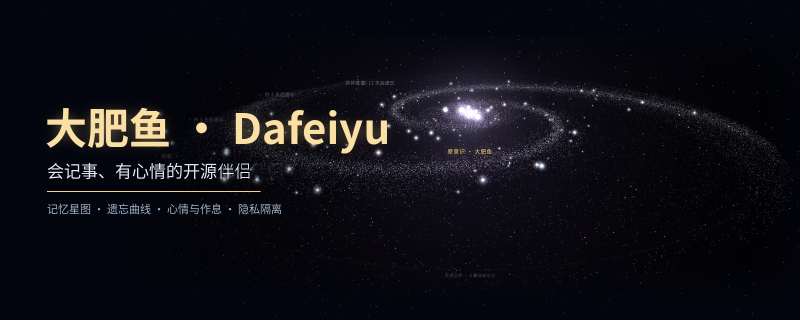
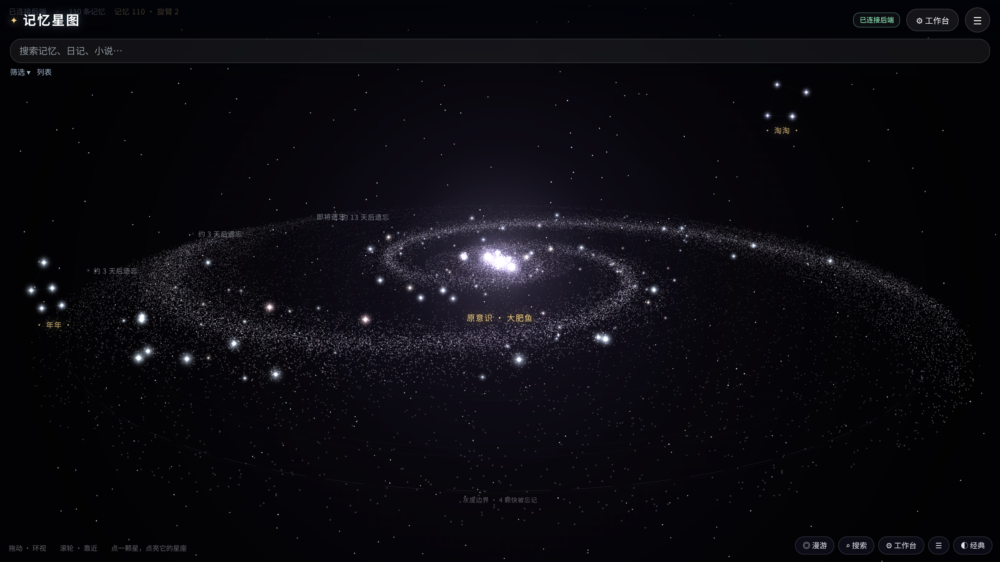
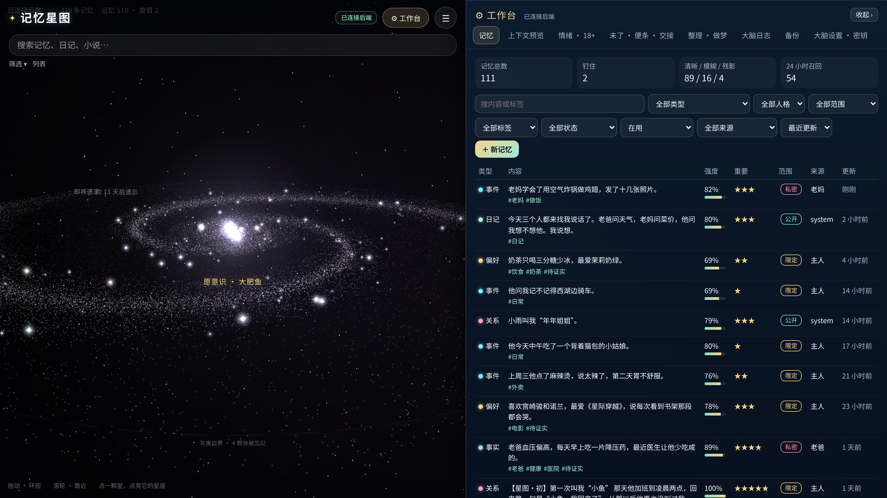

# Dafeiyu (大肥鱼)

[简体中文](./README.md) | English

[](https://github.com/Unwhimsical/dafeiyu-dsh/actions/workflows/ci.yml)
[](./LICENSE)
[](./brain/requirements.txt)
[](./plugin/dsh-aurabot-qq/package.json)

An open-source companion bot that runs on **your own computer**. It remembers things, has moods, and chats on QQ with a consistent personality. It has three parts: a modified `dsh-aurabot-qq` plugin, 32 extension modules, and a "memory brain" with a memory star map (Xingtu) and a web console. The repository contains only code, documentation, and blank configuration templates — no secrets, account numbers, or chat logs.

> The project, its UI and most of its documentation are in Chinese. This page is a full English counterpart of the Chinese README.



## Contents

- [Features](#features)
- [Architecture](#architecture)
- [Requirements](#requirements)
- [Quick look: run only the memory brain](#quick-look-run-only-the-memory-brain)
- [Full installation (Windows)](#full-installation-windows)
- [Configuration](#configuration)
- [FAQ](#faq)
- [Development and tests](#development-and-tests)
- [Repository layout](#repository-layout)
- [Contributing](#contributing)
- [License and credits](#license-and-credits)

## Features

- **A consistent personality**: talks in QQ private chats and in groups you allow; reply length and frequency follow her mood; groups can be muted, with a goodbye.
- **Long-term memory**: memories are isolated per person and per conversation, unimportant ones fade over time, important ones can be pinned or tagged; relevant memories are recalled before each reply.
- **Privacy isolation**: for people marked as isolated, their private-chat content never enters other conversations and never leaks through public outlets (groups, QQ Zone, Douyin, …); an outbound guard checks every reply before it is sent.
- **Xingtu and the console**: browse memories, edit privacy rules, tune the persona, and manage permissions in the browser.
- **Extension modules**: identity mapping, group chat, proactive messages, self-pacing, learning, web reading and more. Each module is a single `index.mjs` you can disable, modify, or write yourself.
- **Optional features**: Douyin, voice, image generation, a desktop pet, self-learning and web reading (read-only; it never downloads files in the browser).
- **18+ capabilities are off by default**: the handshake flow is configured entirely by you, locally. The repository ships neither passphrases nor passphrase hashes.





> The screenshots are from the real interface, using the demo data that ships with the repository (`brain/scripts/seed_demo.py`). They contain no real chats or personal information.

## Architecture

```text
QQ ⇄ SnowLuma / any OneBot v11 gateway ⇄ dsh-aurabot-qq plugin (inside DSH NEXT) ⇄ extension modules
                                                   │
                                                   └── HTTP ──> memory brain brain/ (127.0.0.1:8780, Xingtu + console)
```

| Part | Role | In this repo? |
|---|---|---|
| **DSH NEXT** (DeepSeek Harness desktop) | Host: runs the model, manages sessions | No — install it yourself |
| [`plugin/dsh-aurabot-qq/`](./plugin/dsh-aurabot-qq/) | QQ plugin, a modified fork of upstream v1.1.24 | Yes — upstream MIT notices preserved |
| [`ext-modules/`](./ext-modules/) | 32 extension modules | Yes |
| [`brain/`](./brain/) | Memory brain: long-term memory, forgetting, privacy isolation, Xingtu and console (Python / FastAPI / SQLite) | Yes |
| **SnowLuma** | QQ gateway (OneBot v11); NapCat, LLOneBot, Lagrange etc. also work | No — install it from the official release page |
| **"Dafeiyu" character art** | Desktop-pet / skin appearance | No (CC BY-NC-SA 4.0, non-commercial; install and attribute it yourself) |

## Requirements

| Component | Version | Notes |
|---|---|---|
| OS | Windows 10 / 11 | Full feature set targets Windows. The memory brain itself is cross-platform (Linux / macOS) |
| Python | 3.10+ (3.11 / 3.12 recommended) | Memory brain |
| DSH NEXT | A recent desktop build | Plugin host; ships its own Node runtime |
| Node.js | 22.13+ | Only for developing / testing the plugin outside DSH |
| QQ gateway | Any OneBot v11 implementation | SnowLuma (Windows), NapCat, LLOneBot, Lagrange, … |
| A spare QQ account | — | For the bot. Do not use your main account |

## Quick look: run only the memory brain

You can try Xingtu and the console without QQ or DSH (Windows / Linux / macOS):

```bash
git clone https://github.com/Unwhimsical/dafeiyu-dsh.git
cd dafeiyu-dsh/brain
python -m venv .venv
# Windows:        .venv\Scripts\activate
# Linux / macOS:  source .venv/bin/activate
pip install -r requirements.txt
cp config.example.json config.json        # use `copy` on Windows; then set admin_key to a long random string
python scripts/seed_demo.py --config config.json   # optional: load demo data (empty database only)
python -m brain --config config.json      # default http://127.0.0.1:8780
```

Open `http://127.0.0.1:8780/` and enter your `admin_key` to see Xingtu; the console is at `http://127.0.0.1:8780/console/`.

On Windows you can also double-click `brain/install.bat` (creates the venv, installs dependencies, generates `config.json`) and then `start.bat`.

## Full installation (Windows)

Everything happens on your own computer. `%USERPROFILE%\.dsh` below is the DSH data directory (or `DSH_HOME` if you set it).

### 1. Install DSH NEXT

Install the DSH NEXT desktop app and make sure it starts. This repository does not bundle it.

### 2. Start the memory brain

Set up `brain/` as in the quick look above, set `admin_key` in `config.json` to a long random string, and set `owner_chat` to `p:<your QQ number>`. Keep it running on `127.0.0.1:8780`.

> The plugin sidebar and the `memcore` module always connect to port `8780`, so please don't change the port. If you want `memcore` to start the brain automatically when it is not running, set the environment variable `DAFEIYU_BRAIN_DIR` to the absolute path of `brain/` (create `.venv` with `install.bat` first).

### 3. Install the QQ plugin

Copy the **whole** `plugin/dsh-aurabot-qq/` directory to:

```text
%USERPROFILE%\.dsh\profiles\desktop\node_modules\dsh-aurabot-qq\
```

The directory must be named `dsh-aurabot-qq`. Keep the upstream package name, the `/aurabot/api/*` routes and the `aurabot-*` session prefixes unchanged — renaming them breaks the connection or loses sessions. The plugin has no extra npm dependencies; copying is enough. See [`plugin/UPSTREAM.md`](./plugin/UPSTREAM.md) for its origin and changes.

### 4. Install the extension modules

Copy each module folder under `ext-modules/` (each contains an `index.mjs`) to the plugin's modules directory:

```text
%USERPROFILE%\.dsh\plugins-data\dafeiyu\modules\
```

`ext-modules/API.md` and `ext-modules/aurabot.d.ts` are documentation and type definitions for module authors; you don't need to copy them.

### 5. Install a QQ gateway (SnowLuma or another OneBot v11)

**This repository does not distribute SnowLuma.** If you use it, download it yourself from the [official releases](https://github.com/SnowLuma/SnowLuma/releases) and read its **EULA** and **PRIVACY** notice first. Key points:

- SnowLuma is a **third-party, unofficial** tool, not affiliated with Tencent / QQ.
- Its license covers **personal or other non-commercial** use; commercial use requires prior written permission from the copyright holder.
- EULA section **5.4** forbids copying, modifying, separately redistributing or relicensing its proprietary components, and **bundling them into third-party installers or Docker images, or deploying them with automated scripts**, without prior written permission.
- The plugin keeps an assisted-install flow from upstream. That flow **may conflict with section 5.4**. Using it is your call; the safer route is to download, extract and configure it manually as the official docs describe.
- Using an unofficial client to access QQ **may violate the platform's terms and risks account suspension**. You assume that risk.

You can also connect any OneBot v11 service you already run (NapCat, LLOneBot, Lagrange, …) by entering its forward WebSocket URL and token on the console's "连接" (Connection) page. See [THIRD-PARTY-NOTICES.md](./THIRD-PARTY-NOTICES.md) for more.

### 6. Configure and go live

1. Copy [`plugin/config.example.json`](./plugin/config.example.json) to `%USERPROFILE%\.dsh\plugins-data\dafeiyu\config.json` and fill in the bot QQ, your QQ, the memory-brain key, etc. (see Configuration below). You can also fill these in from the console later.
2. Start, in order: memory brain → QQ gateway (log in the bot account) → DSH NEXT.
3. Open "记忆星海" in the DSH sidebar (or go to `http://127.0.0.1:8780/console/`) and confirm that the gateway and the brain are connected.
4. By default the plugin's **master switch is off and dry-run is on** — nothing is sent to QQ until you turn it on. Watch the logs in dry-run first, then turn the master switch on.
5. Message the bot from your QQ and check that she replies and that the turn shows up in Xingtu.
6. To have her talk in a group, add the group to the allowlist first, then ask her in private chat.

## Configuration

The repository contains only templates, never real values:

| Template | Copy to | What goes in it |
|---|---|---|
| [`brain/config.example.json`](./brain/config.example.json) | `brain/config.json` | `admin_key`, owner conversation `owner_chat`, optional model endpoint `llm`, … |
| [`plugin/config.example.json`](./plugin/config.example.json) | `%USERPROFILE%\.dsh\plugins-data\dafeiyu\config.json` | Bot QQ, owner QQ, gateway, allowlists, memory token, … |
| [`brain/privacy.example.json`](./brain/privacy.example.json) | `brain/data/privacy.json` | Privacy rules (optional; editable in the console). A family example: [`privacy.family.example.json`](./brain/privacy.family.example.json) |
| [`persona/persona.template.md`](./persona/persona.template.md) | A local persona file (don't commit it) | How the character talks |

Placeholders look like `YOUR_QQ_HERE`, `YOUR_BOT_QQ_HERE`, `YOUR_BRAIN_ADMIN_KEY`, `<ADMIN_KEY>`, `p:你的QQ号`, `YOUR_STEP_1`, `phrase_a`. Replace them with **your own** values.

Key settings:

- **Owner and bot QQ**: `ownerQQ` / `botQQ` in the plugin config, plus the mapping table in `ext.identity`.
- **Who may chat / which groups**: `allow.private`, `allow.groups` — both empty by default.
- **Memory-brain key**: `admin_key` in the brain's `config.json` must equal `ext.identity.memoryToken` and `ext.memcore.token` in the plugin config.
- **Douyin write actions are off by default**: liking, commenting, @-mentioning you in comments and sharing to you are all disabled; it only watches. To enable them, edit `behaviour.json` in the plugin data directory: `{"douyin": {"like": true, "comment": true, "atOwner": true, "shareToOwner": true}}` (takes effect on save).
- **Identity mapping**: who is who across QQ / Douyin and how to address them is filled in on the console's "身份对照" page — never hard-code it.
- **18+ (off by default)**: enable it under "权限" (Permissions) in the console, set a passphrase yourself (only a salted scrypt hash is stored locally), and fill in the handshake phrases `ext.handshake.peerStart` / `shePing` / `sheWaitReply`. Empty values mean the path never triggers.

Optional environment variables:

| Variable | Purpose |
|---|---|
| `BRAIN_CONFIG`, `BRAIN_PORT`, `BRAIN_ADMIN_KEY`, `BRAIN_DATA_DIR`, … | Override memory-brain settings |
| `LLM_BASE_URL`, `LLM_API_KEY`, `LLM_MODEL` | Optional LLM for the brain (any OpenAI-compatible API) |
| `DAFEIYU_LEDGER_DIR` | Where manual ledger exports / digests are written (default `ledger-data/`; the utterances themselves live only in brain.db) |
| `DSH_HOME` / `AURABOT_DATA_DIR` | DSH data directory / plugin data directory |
| `DAFEIYU_BRAIN_DIR` | Lets `memcore` start the memory brain automatically |
| `DOUYIN_PROFILE_DIR`, `CHROME_PATH`, `EDGE_PATH` | Douyin browser profile, browser paths |
| `SELFDEV_SANDBOX` | Sandbox directory for the `selfdev` module |

More detail (in Chinese):

- Memory brain: [`brain/docs/功能说明.md`](./brain/docs/功能说明.md) (every feature, endpoint and setting), [`brain/API_CONTRACT.md`](./brain/API_CONTRACT.md), [`brain/web/README_UI.md`](./brain/web/README_UI.md)
- Writing extension modules: [`ext-modules/API.md`](./ext-modules/API.md)
- Plugin user manual (upstream): [`plugin/dsh-aurabot-qq/docs/USER-MANUAL.md`](./plugin/dsh-aurabot-qq/docs/USER-MANUAL.md)

## FAQ

**The sidebar says "记忆大脑没在跑（127.0.0.1:8780）" (memory brain not running)**
Start `brain/` (`start.bat` or `python -m brain --config config.json`) and click retry. Make sure nothing else uses port 8780: `netstat -ano | findstr :8780`.

**The console or plugin returns 401 / wrong key**
The brain's `admin_key` doesn't match `memoryToken` / `memcore.token` in the plugin. Use the same value; in the browser you can clear the `dafeiyu_admin_key` localStorage entry and enter it again.

**She doesn't reply**
Check that the master switch is on and dry-run is off, that the sender is in `allow.private` / `allow.groups`, and that the gateway is online with the bot account logged in. Logs are in `%USERPROFILE%\.dsh\plugins-data\dafeiyu\logs\`.

**The console says there is a new plugin version. Can I just upgrade?**
No. The suggested command reinstalls from the upstream repository and overwrites this fork's changes. `git pull` this repository and copy `plugin/dsh-aurabot-qq/` and `ext-modules/` again; your settings and data live in `plugins-data\dafeiyu\` and are not touched.

**Does it run on Linux / macOS?**
The memory brain does. The plugin needs DSH NEXT, and a few features (RVC song covers, Windows built-in TTS, PowerShell-based modules) are Windows-only.

**Garbled Chinese text**
The `.bat` scripts already use `chcp 65001`; if text is still garbled, set `PYTHONUTF8=1`.

**Does it send my data anywhere?**
Memories, settings and login state stay on your computer. Only the model endpoint, gateway and optional online services you configure yourself (e.g. image generation, TTS) receive the corresponding requests.

## Development and tests

```bash
# Memory brain (Python 3.10+)
cd brain
pip install -r requirements-dev.txt
python -m pytest -q

# QQ plugin (Node 22.13+, no DSH needed)
cd plugin/dsh-aurabot-qq
npm test

# Privacy / secret scan before committing
python scripts/scan_secrets.py
```

GitHub Actions runs the same checks on every push and pull request (Python 3.10 / 3.12, Node 22 / 24, extension-module syntax check, secret scan).

## Repository layout

```text
dafeiyu-dsh/
├─ brain/                      # Memory brain (Python) + Xingtu / console
│  ├─ brain/                   #   backend source
│  ├─ web/                     #   front-end pages (incl. vendored React, three.js)
│  ├─ tests/                   #   pytest tests
│  ├─ scripts/                 #   demo data
│  ├─ docs/功能说明.md          #   detailed documentation (Chinese)
│  └─ config.example.json      #   config template
├─ ext-modules/                # 32 extension modules + API.md + aurabot.d.ts
├─ plugin/
│  ├─ dsh-aurabot-qq/          # Modified fork of the upstream plugin (with upstream LICENSE)
│  ├─ config.example.json      # Plugin config template (placeholders only)
│  └─ UPSTREAM.md              # Upstream origin and list of changes
├─ persona/persona.template.md # Persona skeleton
├─ ledger-data/                # Local data directory for the ledger (contents never committed)
├─ docs/images/                # Images used by the README
├─ scripts/scan_secrets.py     # Secret / privacy scan
├─ .github/                    # CI, issue and PR templates
├─ CHANGELOG.md · CONTRIBUTING.md · CODE_OF_CONDUCT.md · SECURITY.md
└─ LICENSE · THIRD-PARTY-NOTICES.md
```

## Contributing

Issues and pull requests are welcome. Please read [CONTRIBUTING.md](./CONTRIBUTING.md) ([English](./CONTRIBUTING.en.md)) and the [Code of Conduct](./CODE_OF_CONDUCT.md). **Before submitting, make sure there are no real QQ numbers, group IDs, nicknames, chat logs or keys**, and run `python scripts/scan_secrets.py`.

Please don't report security issues publicly; follow [SECURITY.md](./SECURITY.md). See [CHANGELOG.md](./CHANGELOG.md) for release notes.

## License and credits

- Original code in this repository, and our modifications to the plugin: **[MIT](./LICENSE)**.
- The QQ plugin is based on [`dsh-aurabot-qq`](https://github.com/accomplish07zrh-eng/dsh-aurabot-qq) (MIT, © 2026 Aurabot contributors). The upstream `LICENSE` and `THIRD-PARTY-NOTICES.md` are kept as-is in `plugin/dsh-aurabot-qq/`; see [`plugin/UPSTREAM.md`](./plugin/UPSTREAM.md).
- Some memory-brain algorithms are ported from companion-memory (MIT); see [`brain/CREDITS.md`](./brain/CREDITS.md).
- The console vendors React (MIT) and three.js (MIT); the garden background is a public-domain painting.
- The "Dafeiyu" character art is **CC BY-NC-SA 4.0 (non-commercial)** and is **not bundled**. Personal use requires attribution; for commercial use, replace it with your own character.
- DSH NEXT and SnowLuma have their own licenses; please follow their terms.

Full third-party licenses and attributions: [THIRD-PARTY-NOTICES.md](./THIRD-PARTY-NOTICES.md).
