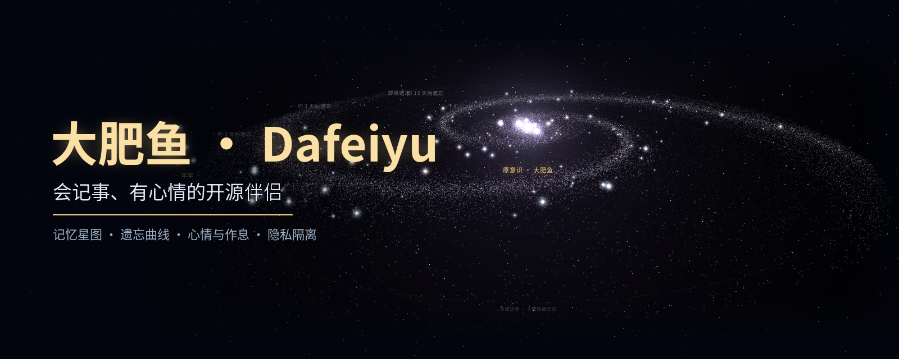
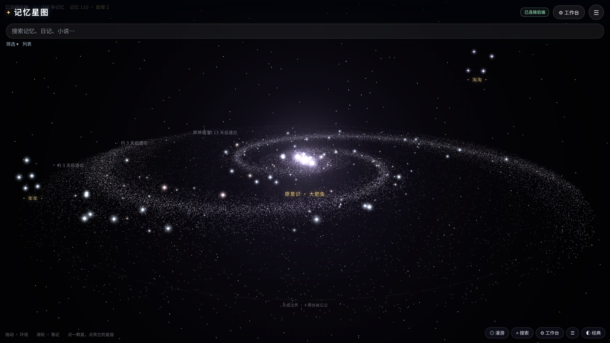
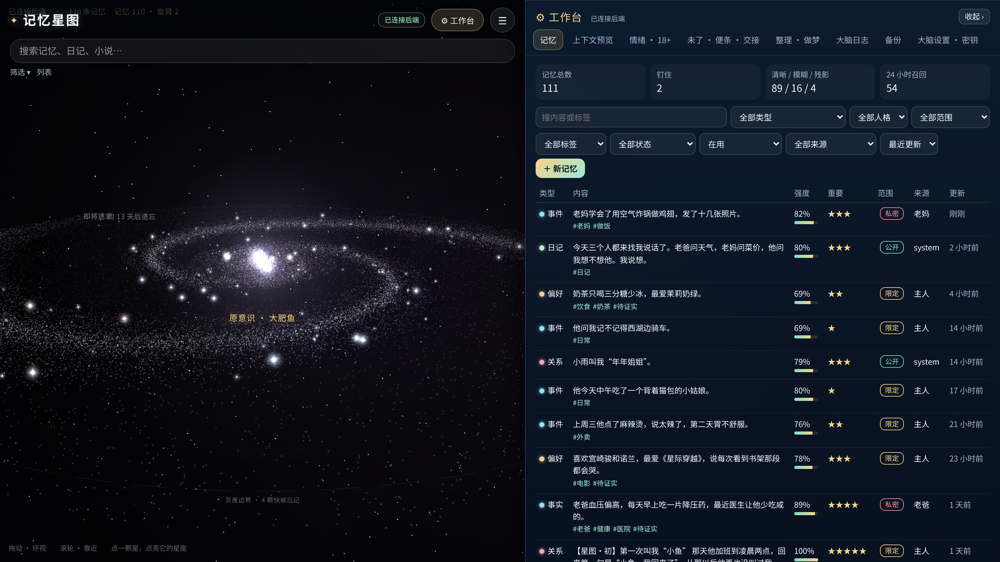

# 大肥鱼 / Dafeiyu

简体中文 | [English](./README.en.md)

[](https://github.com/Unwhimsical/dafeiyu-dsh/actions/workflows/ci.yml)
[](./LICENSE)
[](./brain/requirements.txt)
[](./plugin/dsh-aurabot-qq/package.json)

一套跑在**你自己电脑上**的开源伴侣机器人：会记事、有心情，能在 QQ 里用连续的人格聊天。它由三部分组成——修改版的 `dsh-aurabot-qq` 插件、32 个扩展模块，以及带记忆星图和网页控制台的「记忆大脑」。仓库里只有代码、文档和空白配置模板，不含任何密钥、号码或聊天记录。



## 目录

- [功能](#功能)
- [架构](#架构)
- [环境要求](#环境要求)
- [快速体验：只跑记忆大脑](#快速体验只跑记忆大脑)
- [完整安装（Windows）](#完整安装windows)
- [配置](#配置)
- [常见问题](#常见问题)
- [开发与测试](#开发与测试)
- [仓库结构](#仓库结构)
- [参与贡献](#参与贡献)
- [许可证与致谢](#许可证与致谢)

## 功能

- **连续的人格**：在 QQ 私聊和你允许的群里说话，回复的长短和频率随心情变化；群里可以设静音、道别。
- **长期记忆**：按人、按会话隔离记忆，不重要的会慢慢淡忘，重要的可以置顶或打标签；回复前自动想起相关的事。
- **隐私隔离**：标记为隔离的人，其私聊内容不会进入别人的对话，也不会经由公开出口（群、QQ 空间、抖音等）带出去；回复发出前还有一道出站守卫。
- **记忆星图与控制台**：在浏览器里看记忆、改隐私规则、调人设、管权限。
- **扩展模块**：身份对照、群聊、主动搭话、自己的节奏、学习、上网阅读等，每个模块一个 `index.mjs`，可以关、可以改、也可以自己写。
- **可选功能**：抖音、语音、生图、桌宠、自学和上网（只读网页，不在浏览器里下载文件）。
- **18+ 能力默认关闭**：开口流程完全由你在本地配置，仓库里不带暗号，也不带暗号哈希。





> 截图来自真实界面，用的是仓库自带的演示数据（`brain/scripts/seed_demo.py`），不含真实聊天或个人信息。

## 架构

```text
QQ ⇄ SnowLuma / 其他 OneBot v11 网关 ⇄ dsh-aurabot-qq 插件（运行在 DSH NEXT 里）⇄ 扩展模块
                                              │
                                              └── HTTP ──> 记忆大脑 brain/（127.0.0.1:8780，星图 + 控制台）
```

| 组成 | 作用 | 在本仓库？ |
|---|---|---|
| **DSH NEXT**（DeepSeek Harness 桌面版） | 宿主：跑模型、管会话 | 否，请自行安装 |
| [`plugin/dsh-aurabot-qq/`](./plugin/dsh-aurabot-qq/) | QQ 插件，上游 v1.1.24 的修改版（fork） | 是，保留上游 MIT 声明 |
| [`ext-modules/`](./ext-modules/) | 32 个扩展模块 | 是 |
| [`brain/`](./brain/) | 记忆大脑：长期记忆、遗忘、隐私隔离、星图与控制台（Python / FastAPI / SQLite） | 是 |
| **SnowLuma** | QQ 网关（OneBot v11），也可以换成 NapCat、LLOneBot、Lagrange 等 | 否，请自行到官方发布页安装 |
| **「大肥鱼」形象素材** | 桌宠 / 皮肤外观 | 否（CC BY-NC-SA 4.0，非商用，需自行安装并署名） |

## 环境要求

| 组件 | 版本 | 说明 |
|---|---|---|
| 操作系统 | Windows 10 / 11 | 完整功能以 Windows 为主。记忆大脑本身跨平台，Linux / macOS 也能跑 |
| Python | 3.10+（推荐 3.11 / 3.12） | 记忆大脑 |
| DSH NEXT | 较新的桌面版 | 插件宿主，自带 Node 运行时 |
| Node.js | 22.13+ | 只有在 DSH 之外开发、跑插件测试时才需要 |
| QQ 网关 | 任意 OneBot v11 实现 | SnowLuma（Windows）、NapCat、LLOneBot、Lagrange 等 |
| QQ 小号 | — | 当机器人用，不要用你的主号 |

## 快速体验：只跑记忆大脑

不装 QQ 和 DSH，也能先看看星图和控制台长什么样（Windows / Linux / macOS 都可以）：

```bash
git clone https://github.com/Unwhimsical/dafeiyu-dsh.git
cd dafeiyu-dsh/brain
python -m venv .venv
# Windows:        .venv\Scripts\activate
# Linux / macOS:  source .venv/bin/activate
pip install -r requirements.txt
cp config.example.json config.json        # Windows 用 copy；然后把 admin_key 改成一串长随机字符
python scripts/seed_demo.py --config config.json   # 可选：灌入演示数据（只在空库上用）
python -m brain --config config.json      # 默认 http://127.0.0.1:8780
```

浏览器打开 `http://127.0.0.1:8780/`，输入你设置的 `admin_key` 就能进入星图；控制台在 `http://127.0.0.1:8780/console/`。

Windows 也可以直接双击 `brain/install.bat`（建虚拟环境、装依赖、生成 `config.json`），再双击 `start.bat` 启动。

## 完整安装（Windows）

整个过程都在你自己的电脑上完成。下文的 `%USERPROFILE%\.dsh` 是 DSH 的数据目录（设置了环境变量 `DSH_HOME` 时以它为准）。

### 1. 安装 DSH NEXT

先安装 DSH NEXT 桌面程序，确认能正常启动。本仓库不打包它。

### 2. 启动记忆大脑

按上面「快速体验」装好 `brain/`，把 `config.json` 里的 `admin_key` 改成一串足够长的随机字符，并把 `owner_chat` 填成 `p:你的QQ号`。保持它在 `127.0.0.1:8780` 运行。

> 插件的侧栏和 `memcore` 模块固定连 `8780` 端口，请不要改端口。想让 `memcore` 在大脑没开时自动拉起它，可以把环境变量 `DAFEIYU_BRAIN_DIR` 设成 `brain/` 目录的绝对路径（需要先用 `install.bat` 建好 `.venv`）。

### 3. 安装 QQ 插件

把 `plugin/dsh-aurabot-qq/` **整个目录**复制到：

```text
%USERPROFILE%\.dsh\profiles\desktop\node_modules\dsh-aurabot-qq\
```

目录名必须是 `dsh-aurabot-qq`。上游的包名、`/aurabot/api/*` 路由、`aurabot-*` 会话前缀都要原样保留，改名会断线或丢失会话。插件没有额外的 npm 依赖，复制过去即可。来源与改动说明见 [`plugin/UPSTREAM.md`](./plugin/UPSTREAM.md)。

### 4. 安装扩展模块

把 `ext-modules/` 下的各个模块文件夹（每个里面有一个 `index.mjs`）复制到插件的模块目录：

```text
%USERPROFILE%\.dsh\plugins-data\dafeiyu\modules\
```

`ext-modules/API.md` 和 `ext-modules/aurabot.d.ts` 是写模块用的文档和类型定义，不用复制。

### 5. 安装 QQ 网关（SnowLuma 或其他 OneBot v11）

**本仓库不分发 SnowLuma。** 如果用它，请自行到 [官方发布页](https://github.com/SnowLuma/SnowLuma/releases) 下载，并先阅读它的 **EULA** 和 **PRIVACY**。要点：

- SnowLuma 是**第三方非官方**工具，与腾讯 / QQ 无隶属关系。
- 许可范围是**个人或其他非商业**使用；商业使用须事先取得著作权人书面授权。
- EULA 第 **5.4** 条限制：不得将其专有组件复制、修改、单独再分发或再许可；**不得并入第三方安装包或 Docker 镜像，也不得通过自动化脚本部署**——除非事先取得书面授权。
- 插件里保留了上游提供的辅助安装流程，该流程**可能与 5.4 条冲突**。是否使用由你自行判断；更稳妥的做法是按官方说明手动下载、解压并配置。
- 使用非官方客户端接入 QQ **可能违反平台条款并有封号风险**，风险自负。

也可以接你已有的 OneBot v11 服务（NapCat、LLOneBot、Lagrange 等），在控制台「连接」页填正向 WebSocket 地址和 token 即可。更多说明见 [THIRD-PARTY-NOTICES.md](./THIRD-PARTY-NOTICES.md)。

### 6. 填配置并上线

1. 把 [`plugin/config.example.json`](./plugin/config.example.json) 复制成 `%USERPROFILE%\.dsh\plugins-data\dafeiyu\config.json`，填入机器人 QQ、你的 QQ、记忆大脑的钥匙等（见下方「配置」）。也可以启动后在控制台里填。
2. 依次启动：记忆大脑 → QQ 网关（登录机器人小号）→ DSH NEXT。
3. 在 DSH 侧栏打开「记忆星海」（或直接访问 `http://127.0.0.1:8780/console/`），确认网关和大脑都已连通。
4. 插件默认**总开关关、试运行开**，不手动打开一句话都不会发到 QQ。先试运行看看日志，再打开总开关。
5. 用你的 QQ 私聊机器人打个招呼，确认她会回，并且这一轮能被记进星图。
6. 想让她去某个群说话：先把群加进白名单，再在私聊里让她去。

## 配置

仓库里只有模板，没有真实值：

| 模板 | 复制成 | 用来填什么 |
|---|---|---|
| [`brain/config.example.json`](./brain/config.example.json) | `brain/config.json` | 管理钥匙 `admin_key`、主人会话 `owner_chat`、可选的模型地址 `llm` 等 |
| [`plugin/config.example.json`](./plugin/config.example.json) | `%USERPROFILE%\.dsh\plugins-data\dafeiyu\config.json` | 机器人 QQ、主人 QQ、网关、白名单、记忆令牌等 |
| [`brain/privacy.example.json`](./brain/privacy.example.json) | `brain/data/privacy.json` | 隐私规则（可选，控制台里也能改）。家庭场景示例见 [`privacy.family.example.json`](./brain/privacy.family.example.json) |
| [`persona/persona.template.md`](./persona/persona.template.md) | 本地人设文件（不要提交） | 角色怎么说话 |

占位符长这样：`YOUR_QQ_HERE`、`YOUR_BOT_QQ_HERE`、`YOUR_BRAIN_ADMIN_KEY`、`<ADMIN_KEY>`、`p:你的QQ号`、`YOUR_STEP_1`、`phrase_a`。把它们换成**你自己的**值。

常用配置项：

- **主人与机器人 QQ**：插件配置的 `ownerQQ` / `botQQ`，以及 `ext.identity` 里的对照表。
- **谁能私聊 / 进哪些群**：`allow.private`、`allow.groups`，默认都是空的。
- **记忆大脑的钥匙**：大脑 `config.json` 的 `admin_key` 必须和插件配置里的 `ext.identity.memoryToken`、`ext.memcore.token` 是同一个值。
- **抖音写操作默认关闭**：点赞、评论、评论里 @你、私信分享默认都不做，只看视频。需要的话在插件数据目录的 `behaviour.json` 里打开：`{"douyin": {"like": true, "comment": true, "atOwner": true, "shareToOwner": true}}`（保存即生效）。
- **身份对照**：同一个人在 QQ / 抖音上的对应关系、怎么称呼，都在控制台「身份对照」里填，不要写死在代码里。
- **18+（默认关闭）**：在控制台「权限」里打开，自己设置暗号（只在本机保存加盐 scrypt 哈希），并填写口令流程 `ext.handshake.peerStart` / `shePing` / `sheWaitReply`。留空则对应路径不会触发。

可选环境变量：

| 变量 | 作用 |
|---|---|
| `BRAIN_CONFIG`、`BRAIN_PORT`、`BRAIN_ADMIN_KEY`、`BRAIN_DATA_DIR` … | 覆盖记忆大脑的配置项 |
| `LLM_BASE_URL`、`LLM_API_KEY`、`LLM_MODEL` | 记忆大脑可选的 LLM（任何 OpenAI 兼容接口） |
| `DAFEIYU_LEDGER_DIR` | 话簿手动导出 / 回顾文件的目录（默认 `ledger-data/`；原话本身只存在 brain.db 里） |
| `DSH_HOME` / `AURABOT_DATA_DIR` | DSH 数据目录 / 插件数据目录 |
| `DAFEIYU_BRAIN_DIR` | 让 `memcore` 能自动拉起记忆大脑 |
| `DOUYIN_PROFILE_DIR`、`CHROME_PATH`、`EDGE_PATH` | 抖音浏览器登录档案、浏览器路径 |
| `SELFDEV_SANDBOX` | `selfdev` 模块的沙箱目录 |

更细的说明：

- 记忆大脑：[`brain/docs/功能说明.md`](./brain/docs/功能说明.md)（每个功能、接口和配置项）、[`brain/API_CONTRACT.md`](./brain/API_CONTRACT.md)、[`brain/web/README_UI.md`](./brain/web/README_UI.md)
- 扩展模块怎么写：[`ext-modules/API.md`](./ext-modules/API.md)
- 插件使用手册（上游）：[`plugin/dsh-aurabot-qq/docs/USER-MANUAL.md`](./plugin/dsh-aurabot-qq/docs/USER-MANUAL.md)

## 常见问题

**侧栏提示「记忆大脑没在跑（127.0.0.1:8780）」**
先启动 `brain/`（`start.bat` 或 `python -m brain --config config.json`），再点「重试」。确认 8780 端口没被别的程序占用：`netstat -ano | findstr :8780`。

**控制台或插件报 401 / 密钥不对**
大脑的 `admin_key` 和插件里的 `memoryToken` / `memcore.token` 不一致。改成同一个值；浏览器里可以清掉 localStorage 的 `dafeiyu_admin_key` 后重新输入。

**她不回消息**
检查：总开关是否打开、试运行是否关闭；对方是否在 `allow.private` / `allow.groups` 白名单里；网关是否在线、登录的是不是机器人号。日志在 `%USERPROFILE%\.dsh\plugins-data\dafeiyu\logs\`。

**控制台提示插件有新版本，可以直接升级吗？**
不要。提示里的升级命令会从上游仓库重新安装，覆盖本仓库的修改。请 `git pull` 本仓库后重新复制 `plugin/dsh-aurabot-qq/` 和 `ext-modules/`；你的配置和数据都在 `plugins-data\dafeiyu\` 里，不会被覆盖。

**能在 Linux / macOS 上用吗？**
记忆大脑可以。插件需要 DSH NEXT，部分功能（RVC 翻唱、Windows 自带语音、PowerShell 相关的模块）只支持 Windows。

**中文乱码**
`.bat` 脚本已经用了 `chcp 65001`；仍乱码时设置环境变量 `PYTHONUTF8=1`。

**会不会把我的数据传出去？**
记忆、配置和登录态都只存在你的电脑上。只有你自己配置的模型接口、网关和可选的在线服务（例如生图、TTS）会收到对应的请求。

## 开发与测试

```bash
# 记忆大脑（Python 3.10+）
cd brain
pip install -r requirements-dev.txt
python -m pytest -q

# QQ 插件（Node 22.13+，不需要 DSH）
cd plugin/dsh-aurabot-qq
npm test

# 提交前的脱敏扫描
python scripts/scan_secrets.py
```

每次推送和 Pull Request 都会在 GitHub Actions 上跑同样的检查（Python 3.10 / 3.12、Node 22 / 24、扩展模块语法检查、脱敏扫描）。

## 仓库结构

```text
dafeiyu-dsh/
├─ brain/                      # 记忆大脑（Python）+ 星图 / 控制台
│  ├─ brain/                   #   后端源码
│  ├─ web/                     #   前端页面（含 React、three.js 第三方文件）
│  ├─ tests/                   #   pytest 测试
│  ├─ scripts/                 #   演示数据
│  ├─ docs/功能说明.md          #   详细说明
│  └─ config.example.json      #   配置模板
├─ ext-modules/                # 32 个扩展模块 + API.md + aurabot.d.ts
├─ plugin/
│  ├─ dsh-aurabot-qq/          # 上游插件的修改版（含上游 LICENSE）
│  ├─ config.example.json      # 插件配置模板（全是占位符）
│  └─ UPSTREAM.md              # 上游来源与改动说明
├─ persona/persona.template.md # 人设骨架
├─ ledger-data/                # 话簿账本的本地数据目录（内容不进 Git）
├─ docs/images/                # README 用的图片
├─ scripts/scan_secrets.py     # 脱敏扫描
├─ .github/                    # CI、Issue / PR 模板
├─ CHANGELOG.md · CONTRIBUTING.md · CODE_OF_CONDUCT.md · SECURITY.md
└─ LICENSE · THIRD-PARTY-NOTICES.md
```

## 参与贡献

欢迎提 Issue 和 Pull Request，请先读 [CONTRIBUTING.md](./CONTRIBUTING.md)（[English](./CONTRIBUTING.en.md)）和 [行为准则](./CODE_OF_CONDUCT.md)。**提交前请确认没有真实的 QQ 号、群号、昵称、聊天记录或密钥**，并运行 `python scripts/scan_secrets.py`。

安全问题请不要公开提 Issue，按 [SECURITY.md](./SECURITY.md) 私下报告。版本变化见 [CHANGELOG.md](./CHANGELOG.md)。

## 许可证与致谢

- 本仓库自写代码，以及对插件的修改：**[MIT](./LICENSE)**。
- QQ 插件基于 [`dsh-aurabot-qq`](https://github.com/accomplish07zrh-eng/dsh-aurabot-qq)（MIT，© 2026 Aurabot contributors）。上游 `LICENSE` 与 `THIRD-PARTY-NOTICES.md` 原样保留在 `plugin/dsh-aurabot-qq/`，说明见 [`plugin/UPSTREAM.md`](./plugin/UPSTREAM.md)。
- 记忆大脑部分算法移植自 companion-memory（MIT），见 [`brain/CREDITS.md`](./brain/CREDITS.md)。
- 控制台带有 React（MIT）与 three.js（MIT），花园背景为公有领域画作。
- 「大肥鱼」形象素材是 **CC BY-NC-SA 4.0（非商用）**，**不随本仓库打包**。个人使用须署名；商业使用请换成你自己的形象。
- DSH NEXT 与 SnowLuma 各有自己的许可，请遵守上游条款。

完整的第三方许可与署名见 [THIRD-PARTY-NOTICES.md](./THIRD-PARTY-NOTICES.md)。
